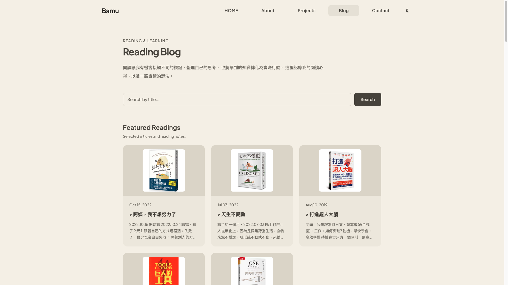
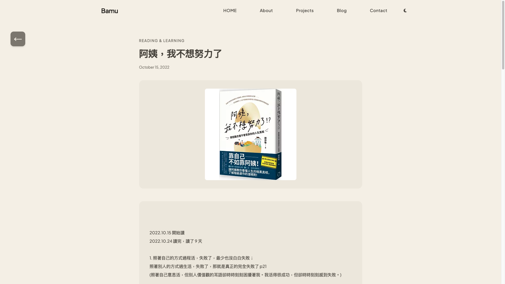
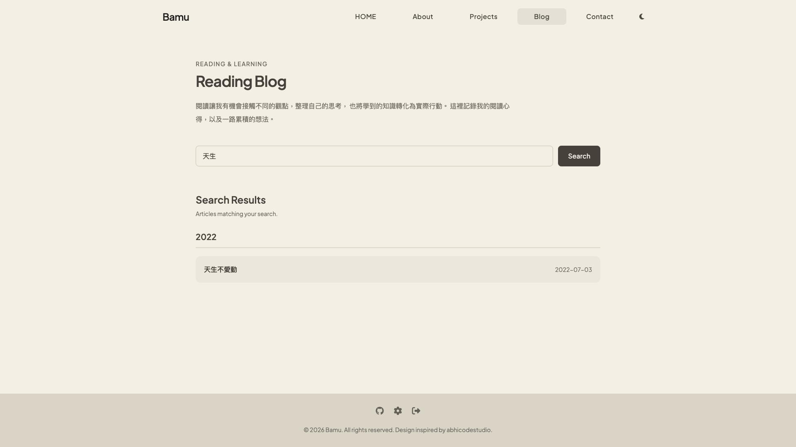
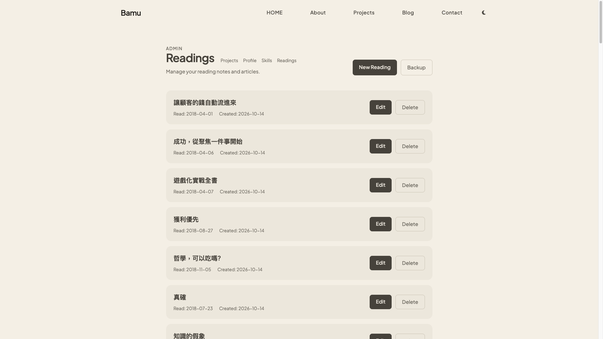
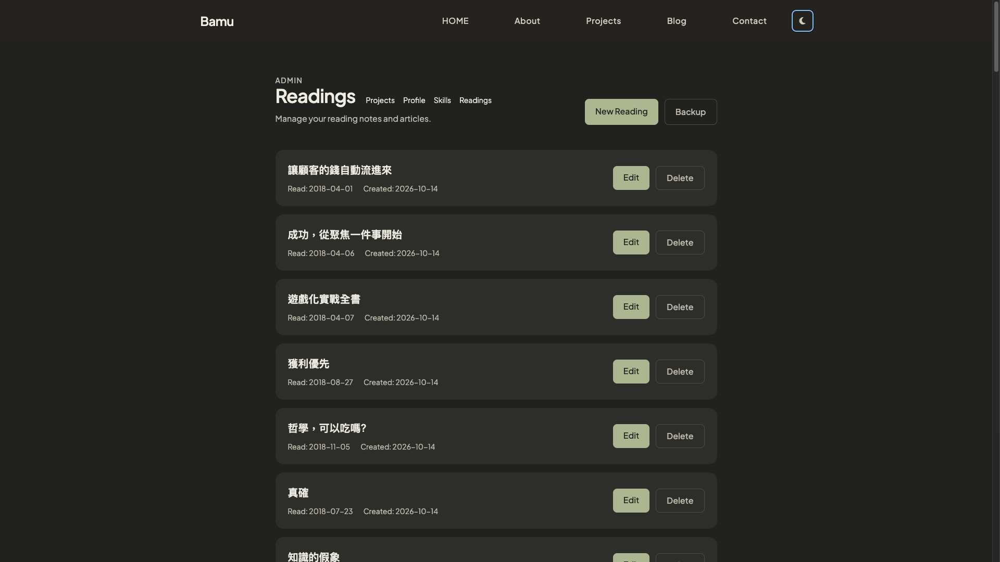

# Bamu Portfolio

使用 **Ruby on Rails 8** 開發的個人作品集與閱讀筆記網站，展示個人介紹、技術技能、開發專案及閱讀紀錄，並提供後台管理介面。

專案以 Rails MVC 架構開發，整合 Tailwind CSS、Stimulus 與 Active Storage，實作個人資料、技能、專案、閱讀筆記及圖片管理功能，並支援全站深色模式切換。


## Demo Admin Account

歡迎使用以下測試帳號登入後台，體驗管理功能。

- **Email：** admin@test.com
- **密碼：** 123456

**登入入口：** 網站頁尾的人物頭像，點擊即可進入管理員登入頁面。

## Features

### Portfolio（前台）

* 個人介紹與技能展示
* 專案列表與詳細頁面
* 專案圖片展示
* 專案相關技術技能呈現
* 響應式網頁設計
* 全站 Dark Mode 深色模式切換

### Admin Dashboard（後台）

* Profile 個人資料 CRUD
* Skill 技能 CRUD
* 技能拖曳排序
* Project 專案 CRUD
* 專案與技能關聯管理
* Project Links 外部連結管理
* Project Images 多圖片上傳與管理

### Image Management（圖片管理）

* 使用 Active Storage 管理專案圖片
* 支援多張圖片上傳
* 管理後台圖片預覽與刪除

### Reading Blog（閱讀筆記）

* 閱讀筆記列表與詳細頁面
* 書籍搜尋功能
* Featured Readings 精選書籍展示
* 閱讀筆記 CRUD
* 多張圖片上傳與管理
* 閱讀資料備份與還原

## Tech Stack

| 分類                   | 技術              |
| -------------------- | --------------- |
| Backend              | Ruby on Rails 8 |
| Database             | PostgreSQL      |
| Frontend             | Tailwind CSS    |
| JavaScript           | Stimulus        |
| Image Upload         | Active Storage  |
| Testing              | Rails Minitest  |
| Version Control      | Git / GitHub    |

## Project Structure

主要資料模型：

* `Profile`：個人介紹資料
* `Skill`：技術技能及排序
* `Project`：作品專案與圖片
* `ProjectSkill`：專案與技能的關聯
* `Link`：專案相關連結
* `Reading`：閱讀筆記內容與書籍圖片

透過 Rails Active Record associations 管理模型之間的關聯，並使用 RESTful routes 與 Strong Parameters 處理後台資料操作。

## Development Highlights

### Admin CRUD

使用 Rails RESTful routes 建立後台管理功能，透過 Strong Parameters 控制資料寫入，實作 Profile、Skill 與 Project 的新增、編輯、刪除及管理功能。

### Skill Drag & Drop Sorting

使用 Stimulus 實作技能拖曳排序，讓管理者能調整技能的顯示順序，並將排序結果儲存至資料庫。

### Project & Skill Associations

使用 Active Record associations 建立 Project、Skill 與 ProjectSkill 之間的多對多關聯，並透過後台管理介面進行專案技能指派。

### Project Images

使用 Active Storage 管理專案多圖片上傳，並建立 ProjectImage 模型管理圖片說明與排序，支援後台圖片預覽及刪除。

### Reading Blog

擴充 Rails Portfolio，建立閱讀筆記系統，包含書籍搜尋、精選書籍展示與詳細頁面。

透過 Admin 後台管理閱讀筆記，使用 Active Storage 支援多張圖片上傳、預覽與刪除，並提供資料備份與還原功能。

### Dark Mode

使用 Tailwind CSS 的 `dark:` 變體與 Stimulus 實作全站深色模式切換，並透過 Local Storage 保存使用者的主題偏好。

針對 Portfolio 與 Reading Blog 分別設計深色配色，維持一致的介面風格與閱讀體驗。

## Screenshots

Home Page


About Me and Technologies


Portfolio Project List


Amiibo Store Project Details


Contact Information


<details>
  <summary>Admin Dashboard Screenshots</summary>
  
  ### Project Management
  


  ### Profile Management
  


  ### Skill Management
  


### Reading Blog

Reading Blog Index



Reading Details



Reading Search



Reading Management



Reading Blog Dark Mode



</details>

## Local Development

### Requirements

* Ruby
* Rails 8
* PostgreSQL
* Node.js

### Setup

```bash
git clone https://github.com/a892842486/bamu-portfolio.git
cd bamu-portfolio

bundle install

bin/rails db:create
bin/rails db:migrate
bin/rails db:seed
```

### Start Server

```bash
bin/dev
```

開啟瀏覽器前往：

http://localhost:3000

## Testing

執行 Rails 測試：

```bash
bin/rails test
```

